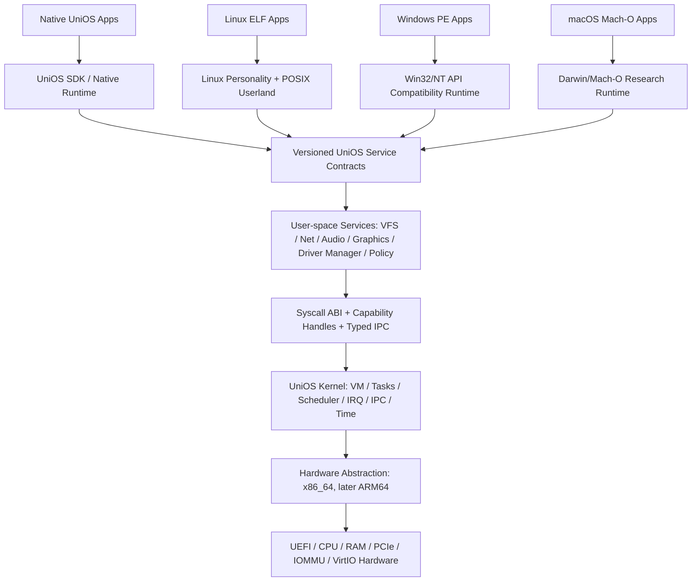

# UniOS — 5대 커널 심층 비교 및 독립 운영체제 기술 설계서

> **문서 상태:** Architecture / Feasibility Draft v0.1 (결정 제안, 미승인)  
> **작성일:** 2026-10-24 (NZDT)  
> **대상 프로젝트:** [White-Fantail/unios](https://github.com/White-Fantail/unios)  
> **중요:** 이 문서는 미승인 연구·설계 초안으로, 수록된 아키텍처·권고·로드맵은 모두 검토 대상이며 확정된 구현 결정이 아니다. Git에 보관하는 목적은 문서 버전 관리이며, 커널·드라이버·런타임 구현은 수행하지 않았다.

## 0. Executive Summary

UniOS는 Linux 배포판, FreeBSD 파생판 또는 다른 OS의 외관 변경이 아니라 **자체 커널과 시스템 서비스, 자체 Native ABI를 가진 독립 운영체제**를 목표로 한다. Linux/Windows/macOS 앱 호환성은 독립 커널의 필수 성질이 아니며 별도의 방대한 엔지니어링 과제로 분리한다.

검토한 다섯 커널은 **Linux, Windows NT, Apple XNU, FreeBSD, Fuchsia Zircon**이다. 이 문서의 주요 권고안은 다음과 같다.

1. **주 아키텍처 후보 A:** Capability 기반 *실용적 마이크로커널/모듈형 커널*; 커널 내부에 스케줄러, VM 주소공간/페이지 관리의 최소 신뢰 부분, IPC, 인터럽트·타이머, Capability 검증만 유지하고 파일시스템·네트워크·대부분의 드라이버를 사용자 공간 서비스에 배치한다.
2. **대안 B:** 최소한의 필수 드라이버/파일시스템 경로를 커널에 통합하는 하이브리드 커널. 성능·초기 부팅 복잡도·장치 지원 검증에서 A가 실패하면 전환 가능하도록 인터페이스를 분리한다.
3. **자체 Native ABI 우선:** UniOS의 객체·권한·서비스 모델을 먼저 정의하며, POSIX/Linux/Win32/Darwin ABI는 독립된 *compatibility personality*와 런타임 계층을 통해 구현한다.
4. **초기 하드웨어 범위를 강하게 제한:** x86_64 UEFI + QEMU/KVM 등 일반적인 VM + VirtIO 장치군을 기준선 후보로 한다. ARM64 및 소비자 노트북의 Wi-Fi/GPU/절전 등은 후속 별도 검증 단계다.
5. **마케팅 가능성 vs 검증 구분:** '세 플랫폼 앱이 모두 실행된다'는 약속 금지. 호환성은 앱·버전·CPU 아키텍처·그래픽/API·드라이버 의존성을 포함한 테스트 매트릭스로만 주장한다.

**설계 핵심:** 성공을 좌우할 가장 큰 병목은 커널 코어의 부팅 자체보다 **드라이버/그래픽/하드웨어 생태계**와 **타 OS의 복잡한 바이너리·프레임워크 호환성**이다.

### 0.1 용어 정의

- **Independent kernel**: UniOS 고유의 privileged kernel image, 메모리/스케줄링/IPC/보안 모델 및 syscall ABI를 소유한다는 의미. 표준 사양(UEFI, PCIe, ELF 등) 또는 적합한 라이선스의 외부 사용자 공간 라이브러리를 사용하는 것은 독립성 상실을 뜻하지 않는다.
- **Native application**: UniOS ABI/SDK를 직접 사용하도록 빌드된 앱.
- **Binary compatibility**: 다른 플랫폼 대상으로 이미 빌드된 바이너리를 수정·재컴파일 없이 실행하는 능력. 동일 ISA, 라이브러리, 시스템 호출, 런타임 및 그래픽 스택을 요구할 수 있다.
- **API compatibility**: 소스/라이브러리 레벨 API 동작 호환. 바이너리 호환과 동일하지 않다.
- **VM compatibility**: 게스트 OS 자체를 가상머신으로 실행하는 방식. 네이티브 바이너리 호환성과 구분한다.
- **TCB (Trusted Computing Base)**: 시스템 보안에 반드시 신뢰해야 하는 코드와 정책 영역.
- **Capability**: 커널 객체를 특정 권한으로 참조하는 위조 불가능한 핸들/참조; 프로세스의 추측 가능한 정수만으로 객체 접근 권한이 생기지 않는다.

---

## 1. 범위, 요구사항, 성공 기준

### 1.1 설계 목표

- G1: 자체 커널과 Native ABI, 자체 부팅 이후 서비스 초기화 규약.
- G2: 기본 프로세스 격리와 최소권한 접근, 견고한 서비스 실패 복구.
- G3: CPU·메모리·IPC·스토리지의 예측 가능한 데스크톱 사용 성능.
- G4: 가벼운 데스크톱, 개발 툴체인, 설치/업데이트 경로를 위한 확장 가능한 시스템 인터페이스.
- G5: Linux ELF, Windows PE, macOS Mach-O의 가능성을 **서로 다른 호환성 문제로** 측정·평가.
- G6: 단일 좁은 플랫폼에서 점진적으로 동작 범위 확장.
- G7: 라이선스·배포·제3자 기술 제약을 처음부터 설계 조건에 포함.

### 1.2 현재 비목표

- 모든 Windows/Linux/macOS 앱의 즉시 실행, Windows/macOS 커널 드라이버 직접 로딩, 완전한 Docker/Linux namespaces, 현대 게임의 광범위한 성능 호환, Apple Silicon 전 기종 지원, 일반 PC Wi-Fi/GPU 무제한 지원, 즉시 상용 출시.
- 제3자 호환성 프로젝트를 '가져다 넣으면 작동한다'고 전제하는 것.
- Linux 커널 코드, XNU 등 기존 커널의 코드 복사를 통해 빠르게 부팅하는 것.

### 1.3 추후 구현 검증에 쓰일 출구 기준(현재는 계획만)

- **커널 안정성:** fault injection에 대한 복구/격리, 패닉 원인 재현, 멀티코어 경쟁 상태에 대한 테스트.
- **IPC/스케줄링:** 단일·다중 코어에서 p50/p99 지연 및 처리량, 서비스 호출 체인별 컨텍스트 스위치 비용 측정.
- **스토리지:** 강제 전원 차단 후 무결성·원자 업데이트 테스트.
- **보안:** 핸들 위조, 권한 증폭, 잘못된 사용자 포인터, DMA/IOMMU 경계 테스트.
- **호환성:** 지정 앱의 시작·종료뿐 아니라 파일, 네트워크, UI, 클립보드, 오디오, 업데이트까지 통과한 기능 단위로 평가.
- **재현성:** 이미지 빌드, 초기화·복구 과정, 테스트 결과가 재현 가능해야 함.

---

## 2. 다섯 커널의 구조 비교

### 2.1 전체 매트릭스

| 항목 | Linux | Windows NT | Apple XNU | FreeBSD | Fuchsia Zircon |
|---|---|---|---|---|---|
| 큰 분류 | 모듈형 모놀리식 | 하이브리드 | 하이브리드(Mach+BSD+IOKit) | 모놀리식/모듈형 | 마이크로커널 계열, 단 '최소 커널' 교조주의는 아님 |
| 핵심 시스템 기능 위치 | 파일시스템·네트워크·대다수 드라이버 커널 | NT Executive·Kernel·HAL, 커널 드라이버 | Mach/BSD/IOKit 주요 기능 커널, DriverKit 사용자 공간도 사용 | VM/VFS/네트워크/대다수 드라이버 커널 | 코어 스케줄링·VM·IPC 커널, 파일시스템·드라이버·네트워크 사용자 공간 |
| 프로세스/권한 모델 | PID, UID/GID, LSM, namespace/cgroup/FD 등 | 프로세스·스레드·Job, 객체 관리자, 토큰/ACL/핸들 | Mach task/thread/port + BSD process/credential | POSIX process/thread, Capsicum, jail/MAC 등 | Job/process/thread와 권한이 부착된 object handle |
| IPC 대표 | pipe/socket/futex/shared memory 등 | ALPC 등 여러 IPC 및 동기화 객체 | Mach port/message + BSD 계층 | pipe/socket/kqueue/shared memory 등 | channel, socket, port, VMO, event 등 |
| VM 추상화 | page cache, mmap, COW, demand paging | section/view, demand paging, COW, working set | Mach VM object/map + BSD 통합 | VM object + unified buffer cache | VMAR/VMO 기반 |
| 드라이버 확장 | 커널 모듈과 사용자 영역 일부 | WDM/WDF, I/O stack, 일부 user-mode | IOKit kext(레거시)와 DriverKit | KLD/newbus | 사용자 공간 DFv2 driver host |
| ABI 전략 | 안정적 userspace syscall ABI; 커널 내부 ABI는 비안정 | Win32/NT 이중 계층의 장기간 호환성 | Darwin ABI·Mach-O·Apple frameworks 결합 | FreeBSD/POSIX 및 선택적 Linuxulator | Zircon syscall/vDSO, FIDL 기반 서비스 프로토콜 |
| 대표 강점 | 장치/서버/컨테이너/성능 생태계 | 객체·드라이버 계약·레거시 앱 호환 | Mach/BSD 서비스 통합, 플랫폼 최적화 | 커널+userland의 통합 운영 | 기본 권한 분리·서비스 격리·객체 모델 |
| UniOS가 피할 점 | 커널 복잡도와 막대한 공격면 | 비공개 내부 구조 의존 | Apple 통제 HW/비공개 프레임워크 의존 | 드라이버 범위 제약, 모놀리식 TCB | 드라이버 생태계 공백·IPC/서비스 복잡도 |

**주의:** 분류는 설계 원리를 구분하기 위한 간명한 설명일 뿐 모든 서브시스템이 같은 위치에서 실행됨을 뜻하지 않는다. 예컨대 최신 macOS에는 DriverKit 사용자 공간 드라이버가 있으며 Linux에도 사용자 공간 장치 경로가 존재한다. 참조 [S1–S10].

### 2.2 Linux — 확장 가능한 모놀리식 커널의 현실적 이점

**아키텍처:** 스케줄러, 주소공간/물리메모리, VFS, 페이지 캐시, 네트워크 스택, 디바이스 모델, 보안 훅과 주요 드라이버가 커널 주소공간 내에서 긴밀히 연계된다. 커널 모듈은 배포와 확장은 쉽게 하지만 프로세스 격리와 동일하지 않다. 커널 내부 인터페이스는 안정적 드라이버 ABI로 약속되지 않는 반면 userspace syscall ABI는 강하게 유지된다 [S1][S2].

**스케줄러:** 리눅스는 여러 스케줄링 클래스를 제공하고 일반 공정 스케줄링은 EEVDF 기반으로 진화했다. EEVDF는 가상 런타임과 virtual deadline 개념을 사용한다 [S3]. **이름만 모방하지 않고** UniOS는 데스크톱 반응성·백그라운드 격리·실시간 정책을 평가해야 한다.

**메모리·파일:** mmap/page cache/COW, NUMA, DMA, huge pages 등 높은 기능 완성도. **장점**은 파일/페이지 캐시와 I/O 경로 최적화; **단점**은 성숙도를 따라잡는 난도와 커널 내 복잡성.

**호환성 함의:** Linux ELF를 로드하는 것은 첫 단계에 불과하다. `clone`/`fork`/`execve`/`futex`/`epoll`/signals/`mmap`/`ioctl`/`/proc`/`/sys`, 라이브러리 로더, glibc/musl, 특정 namespace/cgroup와 GPU·오디오 드라이버 API까지 앱에 따라 요구한다. 단순 POSIX만으로 현대 Linux 앱 호환은 부족하다.

**UniOS 적용:** 안정적 user ABI 정책, 테스트 인프라, 관측성 및 스케줄링 개념을 참고한다. 커널 내부 구현 복제나 Linux 전용 커널 모듈 호환을 1차 목표로 두지 않는다.

### 2.3 Windows NT — 객체 모델과 호환성의 엔지니어링

**아키텍처:** low-level kernel이 스레드 디스패치, 인터럽트, 동기화 등을 담당하고 NT Executive의 object manager, memory manager, process/thread manager, I/O manager, security reference monitor, configuration manager 등이 협업하며 HAL이 HW 차이를 추상화한다 [S4]. NT는 단순한 전통적 마이크로커널이라기보다 **하이브리드**로 보는 것이 적절하다.

**객체 모델:** Files, devices, sections, events, processes, threads, jobs 등에 타입·이름·접근 권한을 가지는 커널 객체가 존재한다. Handle과 ACL·Access Token 기반 접근 검사를 제공한다 [S5]. 시스템 서비스 수명 및 객체 권한을 API 계약으로 정의하는 것이 배울 부분이다.

**스케줄링/입출력:** 우선순위 중심 선점 스케줄링, IO manager의 IRP와 장치 스택, PnP/전원 상태 관리가 중요한 구조적 특징이다 [S4][S6]. 범용 데스크톱 제품에서 드라이버, Plug & Play, 절전·복원은 커널 코어만큼 중요한 과제다.

**호환성 함의:** PE/COFF 실행 로더, DLL 로딩, Win32 API, NT object semantics, synchronization, COM, registry, graphics Direct3D/GDI, 폰트와 쉘, .NET 및 설치 프로그램을 구분해야 한다. Windows 커널 드라이버와 일부 anti-cheat/DRM은 일반 Win32 호환층의 범위를 초과한다.

**UniOS 적용:** typed object API, 핸들 수명, 비동기 I/O, service version contract, 드라이버 계약을 참고. ACL 계층 전체를 커널 표준으로 채택하기보다 기본 capability와 사용자 공간 정책 엔진의 조합을 검토한다. 공개 문서 기반 설계를 원칙으로 하며 비공개 코드/내부 API 사용은 제외한다.

### 2.4 Apple XNU — Mach와 BSD를 통합하는 하이브리드

**아키텍처:** Apple 공개 XNU 소스의 핵심 구성은 `osfmk`(Mach), `bsd`, `iokit`, `libkern`, `pexpert` 등이며 Mach task/thread, VM, IPC와 BSD 프로세스·파일/네트워크 서비스가 결합한다 [S7]. 이를 '순수 마이크로커널'로 설명하면 틀린다. 일부 핵심 기능이 같은 커널 주소공간에서 동작한다.

**IPC·VM:** Mach port/right, task, message, VM object는 객체 지향적 자원 모델의 고전적 사례다 [S8]. 하지만 macOS 앱 실행에 필요한 것은 XNU만이 아니다. Mach-O/dyld, libSystem, Objective-C runtime, Foundation/AppKit/CoreFoundation/CoreGraphics/Metal, XPC/LaunchServices, 코드 서명 등 서로 다른 층에 걸친 서비스가 필요하다.

**드라이버:** 레거시 IOKit/kext와 함께 현대 macOS의 DriverKit은 사용자 공간에서 드라이버를 실행한다 [S9]. 이는 서비스 격리를 통한 안정성 확보의 실제 선례다.

**UniOS 적용:** 커널 메시지와 POSIX-facing 서비스를 분리한 계층화 아이디어를 참고한다. 동일 서비스를 여러 스타일의 API로 노출할 때 발생하는 의미 중복·관리 비용은 피한다. Apple 소스의 APSL-2.0 고유 조건/헤더를 검토하고, macOS의 공개 XNU와 비공개 상위 프레임워크를 혼동하지 않는다 [S21].

### 2.5 FreeBSD — OS 전체의 일관성과 명시적 경계

**아키텍처:** 커널·유저랜드를 함께 관리하는 통합 OS로, VFS, VM, TCP/IP 및 커널 드라이버를 성숙한 BSD 구조로 묶는다 [S10]. VM object와 통합 버퍼 캐시, COW 계층의 설계는 주목할 만하다 [S11]. `newbus`와 KLD는 하드웨어 발견/드라이버 수명주기의 선례다 [S12].

**프로세스 격리:** Unix 권한 외에 jail, Capsicum 등의 제한 모델이 있다. 하지만 개발자가 안전한 인터페이스를 실제로 선택하지 않으면 기본 프로세스가 자동으로 최소 권한이 되는 것은 아니다.

**검증된 호환성 선례:** FreeBSD `Linuxulator`는 재컴파일하지 않은 Linux 바이너리를 실행하는 별도 Linux ABI 호환 계층이다. 그럼에도 cgroups/namespaces 등 일부 Linux 특화 기능에 미지원 범위가 남는다 [S13]. 이는 UniOS에 있어 '독립 커널+다른 OS 바이너리 호환은 가능하지만 비용이 지속 발생한다'는 강력한 사례다.

**UniOS 적용:** 버전별 일관된 userland+kernel 릴리스 모델, VM object 개념, 깨끗한 내부 인터페이스와 강한 시스템 문서화를 참고한다. 모놀리식 구현을 택하지 않더라도 통합 제품 경험은 중요하다.

### 2.6 Fuchsia Zircon — Capability와 사용자 공간 시스템 서비스

**아키텍처:** Zircon은 microkernel에서 영향을 받았지만 극단적으로 작아지는 것 자체를 목표로 삼지 않는다. 커널이 프로세스/스레드, VM, IPC 및 하드웨어 지원 프리미티브를 제공하며 파일시스템·네트워크·많은 드라이버가 사용자 영역에 있다 [S14][S15].

**객체 모델:** Job/process/thread, VMAR/VMO, channel, port, socket, event 등이 핵심 객체다. 핸들은 *프로세스 지역적*이며 핸들별 `rights`를 검증한다; 이전 가능한 핸들의 권한은 축소될 수 있다 [S16]. 이름 검색이 권한 부여를 대신하지 않는다.

**Driver Framework:** DFv2는 사용자 공간 driver manager/driver host, capability-based 서비스 통신을 조직한다. 단, Fuchsia 문서 자체가 드라이버 프레임워크 ABI 안정성이 아직 확립되지 않았다고 언급한다 [S17]. 설계가 아름답다는 이유만으로 현실의 드라이버 수급 문제가 해결되지 않는다.

**성능 함의:** 사용자 공간 경계의 이점은 격리, 업데이트, crash containment이다. 비용은 IPC, 컨텍스트 스위치, 서비스 의존성, 공유 버퍼 동기화와 디버깅 복잡도다. 공정한 평가는 zero-copy/shared-memory fast path를 포함해 동일 워크로드에서 측정해야 한다.

**UniOS 적용:** capability handles, job/resource group, typed IPC, user-mode driver, service restart를 강하게 추천한다. 그러나 복제 지향이 아니라 UniOS 고유의 ABI·권한 모델을 명시한다.

### 2.7 커널별 교훈 종합

| 선택할 아이디어 | 근거 커널 | UniOS 반영 수준 | 피해야 할 오해 |
|---|---|---|---|
| 안정적 user ABI | Linux/Windows | 강한 권고 | 모든 ABI를 v1부터 구현한다는 뜻 아님 |
| typed object/handle 관리 | NT/Zircon | 강한 권고 | NT namespace 또는 Zircon syscall을 그대로 복제하지 않음 |
| Capability 기본 권한 | Zircon/Mach | 강한 권고 | 권한 철회·위임이 공짜는 아님 |
| 사용자 공간 드라이버 | Zircon/DriverKit | 원칙적 채택 | 모든 HW 드라이버가 처음부터 user-space 가능은 아님 |
| unified VM/cache 관점 | Linux/FreeBSD/XNU | 설계 참고 | 페이지 교체 알고리즘까지 조기 확정하지 않음 |
| 제품 전체의 일관된 릴리스 | FreeBSD/Fuchsia | 강한 권고 | 드라이버 ABI도 자동 안정화된다는 뜻 아님 |
| 멀티 personality 호환 | FreeBSD Linuxulator / Wine / Darling | 독립 연구 축 | 바이너리 로더만으로 호환성 달성 안 됨 |
| 성능 최적화 | Linux/NT/XNU | 벤치마크 후 최적화 | 마이크로커널은 무조건 느리거나 빠르지 않음 |

---

## 3. UniOS 후보 아키텍처 평가 및 권고

### 3.1 대안 세 가지

**A. 실용적 Capability 마이크로커널** (주 권고)
- 커널: CPU 예외·인터럽트, 주소공간, 저수준 page mapping, thread/scheduler, handle/IPC, timers, 보안 검증.
- 사용자 공간: process lifecycle policy, VFS/파일시스템, 네트워크, 장치 관리자·드라이버, compositor/오디오, POSIX/호환성 서비스.
- 장점: TCB 축소 가능, service restart, 격리, API 분리.
- 단점: 드라이버 재작성과 IPC 최적화, 페이저/부팅 의존성, 디버깅이 어렵다.

**B. 명시적 모듈 경계의 하이브리드 커널** (Plan B)
- 시작/성능의 핵심 경로에 필요한 서비스 일부를 커널에 두고 동일 인터페이스로 다른 기능을 user space 제공.
- 장점: 성숙한 OS들과 비슷한 데이터 경로, 제한된 인원으로 먼저 하드웨어를 작동시킬 가능성.
- 단점: 신뢰 기반 확대, 커널 패닉 공격면, 장기 분리 전환 비용.

**C. 완전 모놀리식** (기본안으로 비권고)
- 장점: 유사 기존 설계 자료 풍부, 초기 syscall+VFS 연결이 비교적 직접적.
- 단점: 독립 OS의 신규 차별화(기본 격리/모듈성)가 약해지고 커널 기능 확장 부담이 크다.

### 3.2 정성 평가 — 검증 전 가설

점수: 1=불리, 5=유리. **실측이 아닌 설계 토론용 가중치 없는 판단**이다.

| 기준 | A: microkernel-like | B: hybrid | C: monolithic |
|---|---:|---:|---:|
| 서비스 오류 격리 가능성 | 5 | 3 | 2 |
| 최소권한 설계 자연스러움 | 5 | 3 | 2 |
| 초기 구현 경로의 단순성 | 2 | 3 | 3 |
| 데이터 경로 지연 예측 용이성 | 2 | 4 | 4 |
| 장치 드라이버 이식 여건 | 2 | 3 | 3 |
| 호환성 personality 분리 | 5 | 4 | 3 |
| 장기 업데이트/확장 경계 | 5 | 3 | 2 |
| 종합 권고 | **1차 연구 후보** | **필수 비교 대안** | 보조 비교 |

이 점수로 아키텍처를 확정하지 않는다. **A의 boot-critical service outage와 IPC 지연이 수용 불가능하면 B를 재검토하는 Decision Gate**를 둔다.

### 3.3 시스템 계층도(안)

**읽는 법:** 호환층은 동일 커널 위의 서비스/라이브러리 묶음이다. 별도의 게스트 OS를 부팅하는 VM 경로는 아래의 선택적 Hypervisor/VM 서비스를 통해 별도로 제공하며, 도식의 세 호환층이 무조건 작동한다는 의미가 아니다.

---

## 4. 상세 핵심 커널 설계 (제안, 모두 미확정)

### 4.1 CPU/하드웨어 아키텍처와 부팅

- 첫 검증 ISA 후보: **x86_64 (64-bit only)**. UEFI, ACPI, APIC/x2APIC, paging, SMP 및 VirtIO를 주요 설계 기준으로 삼는다. ARM64는 인터페이스 설계 수준에서 고려하되 실제 포팅은 후속이다.
- 부팅 프로토콜은 공인 UEFI 사양을 참조하며 EFI 프로그램/부트로더의 역할과 UniOS 커널 이미지의 역할을 분리한다 [S18].
- 논리 부팅 순서: UEFI firmware -> 부트로더/검증 -> 메모리 맵/펌웨어 정보 -> UniOS kernel entry -> MMU/물리 allocator/CPU exception/scheduler -> root capability -> 첫 user-space supervisor -> 서비스 종속 그래프 -> native login/shell/compositor.
- 초기 root FS는 검증 가능한 읽기 전용 시스템 이미지(또는 임시 initramfs에 상당하는 UniOS 이미지) 중심으로 설계한다. 안전한 영속 저장소와 검증된 업데이트는 별도의 마일스톤.
- 초기 시뮬레이션 표준 장치: VirtIO block/net/console/input, 단순 framebuffer; GPU/USB/Wi-Fi는 검증 확대 대상.
- 부팅 실패 보호: 제한된 초기 신뢰 코드, last-known-good slot 또는 recovery path, 부트 로그 ring buffer, watchdog 정책(후속).

**보류 결정:** 외부 부트로더 vs 자체 UEFI loader, 페이지 크기 및 4/5-level paging 옵션, ACPI 실행 런타임의 위치, 보안 부팅 서명 정책.

### 4.2 커널 객체 및 Capability 모델

| 객체 유형(초안) | 의미 | 가능한 권한의 예 |
|---|---|---|
| `Task` | 자원/주소공간 소유 단위 | inspect, control, terminate |
| `Thread` | 스케줄 가능한 실행 단위 | start, pause, set-policy |
| `ResourceGroup` | 부모·자식, 예산, 라이프사이클 | create-child, set-budget, destroy |
| `AddressSpace` | 가상 주소 영역 | map, unmap, protect |
| `MemoryObject` | 페이지 기반 공유/익명/파일 연계 객체 | read, write, map, duplicate |
| `ChannelEndpoint` | typed IPC endpoint | send, receive, transfer |
| `Event`/`WaitSet` | 상태 동기화/대기 | signal, wait |
| `Interrupt`/`IoRegion` | 장치/IRQ의 제한적 제어 | bind, acknowledge, map |
| `DeviceResource` | MMIO/PIO/DMA 자원 | device-specific |

- Handle = 프로세스 지역 테이블 인덱스+세대 정보 등 구현 선택 + 객체 참조+권한 마스크. 커널에서 타입·권한·수명 검사.
- 서버가 가진 권한을 다른 서비스로 위임할 때 **권한 축소는 허용, 임의 상승은 금지**. 단순히 객체 이름/경로를 알고 있다는 이유로 권한을 얻을 수 없음.
- Handle generation reuse, use-after-free, race with close/transfer, cyclic object lifetime를 명시적 위협 모델에 포함.
- **권한 회수(Revoke) 보류:** delegated capability tree를 통한 부분 철회는 비용과 복잡도가 큼. 초기에는 서비스/리소스 그룹 단위 회수·새 세션 발급 등을 우선 평가하고, 영구적 접근 토큰 정책과 세부 revoke 인터페이스를 RFC로 정의.
- 디버깅/관리 권한도 보통의 user process가 소유하지 않는다. root 권한을 무한한 암묵적 우회로 두지 않고 privileged broker+감사 로그 접근을 검토.

### 4.3 프로세스·스레드·스케줄러

- Task(자원 소유), Thread(실행), ResourceGroup(수명 및 quota)을 구분한다. POSIX `fork` 구조를 커널 Native API의 필수 정체성으로 만들지 않는다; Linux personality에서 필요한 복제 의미는 별도 어댑터로 제공.
- 선점형 per-CPU runqueue/SMP; 최소 두 class **fair/interative**와 **real-time** 후보. 작업 그룹별 CPU budget과 우선순위 역전 방지(priority inheritance/donation for IPC) 설계.
- 일차 목표: UI/입력/오디오 등 시간민감 서비스가 배경 작업으로부터 간섭받지 않도록 latency budget 제공. 공정성 계산 방식(EEVDF 유형 vs 다단계 피드백)은 benchmark 이전 미확정.
- 전원/이종 코어/NUMA CPU 배치 최적화는 후속. RT 예약 정책 없는 무제한 높은 priority 허용 금지.
- 서비스 우선순위 donation의 transitive chain, deadlock, cancellation, timeout을 반드시 문서화.

### 4.4 메모리 관리

- 커널: 물리 프레임 allocator, 페이지 테이블과 page fault 처리, address space mapping/unmapping, guard page, shared memory, COW의 저수준 보호.
- Userland pager/file-backed memory와 page cache 통합은 아키텍처 결정 사항. **부팅 필수 커널 메모리의 페이저 재진입/교착**을 허용하지 않는 별도 보호 영역 필요.
- `MemoryObject`와 `AddressSpace` 분리: 메모리 객체의 공유와 서로 다른 주소공간 매핑을 독립적으로 제어.
- 초기에는 수요 페이징/익명 메모리/공유 메모리로 축소 검증하고 swap/NUMA/memory pressure notifications/huge pages는 기능 게이트 후 검토.
- `W^X`, NX, ASLR/KASLR, user-kernel copy validation, guard stack, 페이지 0 접근 보호, 커널 주소 공간 보호 기법(지원 HW 조건부)을 보안 기본값 후보로 둔다.
- IOMMU 없는 DMA 장치를 user driver에 할당할 경우 격리 보증이 불가능할 수 있으므로 **trusted driver exception** 또는 지원 중단으로 정책을 제한.

### 4.5 IPC: 메시지, 공유 메모리, 대기

- 기본: `ChannelEndpoint`의 bounded typed message, request ID, timeout/cancellation, 권한 핸들 transfer. IPC는 커널 객체를 다루는 최소 프로토콜이며 서비스 의미는 상위 IDL에 둔다.
- 큰 데이터: message에는 `MemoryObject` 핸들/offset/length만 전달하고 zero-copy 가능성을 검증. 공유 버퍼 소유권/수명/동기화 명시.
- waitset/poll: 다중 channel/event/timer를 하나의 대기 큐에 등록, lost wakeup과 backpressure 방어.
- IPC 계약: byte ordering, 버전, 유효 payload 제한, 핸들 전송 규칙, schema compatibility, 오류 코드, client disconnect 시 정리, peer restart 탐지.
- 서비스 장애: 호출 중 서버 사망 시 `PEER_CLOSED` 등 결정된 오류를 반환하고 상위 감독자가 재기동; 재시도 가능한 호출과 non-idempotent 호출을 구분.
- 기본 목표는 *IPC를 가능한 빠르게 만드는 것*이 아니라 **상태·권한·고장 의미를 정의한 뒤 데이터로 병목을 찾는 것**.

### 4.6 Syscall ABI / native API

**설계 원칙**
- UniOS syscall ABI는 `handle`, memory, task/thread, IPC, event, time, constrained device primitives 정도의 **최소 안정 코어**.
- 파일 열기, DNS, UI 생성과 같은 기능은 기본적으로 서비스 프로토콜/SDK에서 제공한다. `read`/`open`이라는 이름이 있다고 커널이 Unix syscalls를 반드시 가져야 한다는 뜻이 아니다.
- syscall 번호, 인자 크기, alignment, 32/64 비트 layout, 오류 규약, cancel semantics를 ABI 문서로 고정; public ABI 추가 시 버전/기능 탐색.
- 커널 객체의 내부 구조와 syscall ABI를 분리하고 각 서비스 프로토콜에 semantic versioning + compatibility window 정책.
- 예시 API 명칭은 **설명용 가상 인터페이스**이며 구현 결정/코드가 아니다.

### 4.7 서비스 감독, 네이밍 및 정책

- `ServiceSupervisor`가 부팅 의존성 그래프와 health/restart policy를 관리. root service 권한은 부팅 시 봉인된 선언형 manifest로 한정.
- `ServiceRegistry`는 서비스 이름을 연결하지만, **이름 발견과 접근 권한 부여를 분리**한다. 서비스 연결 시 broker가 ACL/사용자 요청/Capability 정책 결정.
- crash loop에서는 무한 재시작 금지(지수 backoff, 안전 모드); 필수 서비스와 선택 서비스의 장애 도메인 분리.
- Native app sandbox: manifest + 인스턴스별 Capability grant, 파일/네트워크/화면캡처/마이크의 사용자 동의 범위, IPC 권한 최소화.

### 4.8 VFS, 저장소, 업데이트

- 앱에 보이는 namespace는 per-app/per-personality 정책을 지원. VFS는 user service 후보이며 파일 핸들 접근은 Capability와 연결.
- 읽기전용 기본 시스템 이미지 + 사용자 데이터 볼륨 구분. 파일시스템은 초기 설계에선 단순·안정성을 우선; 복잡한 snapshot/transaction FS 자체 개발은 후순위.
- crash consistency, fsync/write ordering, journaling 또는 COW, TRIM, ACL/metadata/extended attributes와 Unicode 처리 요구 정의.
- 시스템 이미지는 서명·검증/dual slot·rollback을 검토. 패키지 저장소는 서명, 공급망 신뢰, 원자 업그레이드를 독립 요구사항으로 둔다.
- 플러그인 ABI·fs consistency를 보증할 근거 없이 커널 업데이트와 서비스 업데이트를 무조건 독립적으로 수행한다고 약속하지 않는다.

### 4.9 장치·드라이버·전원

- driver manager가 PCI/ACPI 등 장치 목록과 바인딩 규칙을 관리; 사용자 공간 드라이버에 MMIO/IRQ/DMA 할당 권한을 필요 최소로 부여.
- generic devices(virtio-console/net/block/input, framebuffer) 중심으로 첫 하드웨어 범위를 제한하고 USB xHCI, NVMe, HID, Wi-Fi, audio, GPU, Bluetooth, suspend/resume는 단계별 확장.
- PnP의 실제 난점은 detect보다 **hotplug detach 중 DMA 중단, outstanding I/O 취소, 전원 전이, resume 후 재발견**이다.
- User-mode driver crash 시 host process만 재시작할 수 있더라도 장치 상태/펌웨어/DMA가 정상이라고 보장하지 않는다. device reset/rebind 절차와 IOMMU 검사 필수.
- Linux/Windows/macOS 드라이버 바이너리는 ABI·커널 내부 계약이 다르므로 **직접 로딩 대상 아님**. 새 드라이버 또는 라이선스가 허용하는 부분 포팅이 필요하다.

### 4.10 그래픽, 입력, 오디오 및 UX

- 1차: 콘솔과 단순 framebuffer, 기본 입력·2D compositor의 기술 가능성만 설계.
- 2차: VirtIO GPU 또는 소프트웨어 렌더러, 창 관리, vsync, 다중 모니터, HiDPI, clipboard, IME 접근성 계획.
- 3차: Vulkan/OpenGL, 하드웨어 가속, 색 관리/비디오 codec/카메라. GPU 드라이버와 유저 공간 그래픽 런타임의 계약이 크므로 반드시 독립 프로젝트로 취급 [S19].
- Windows Direct3D, Linux Vulkan/OpenGL, macOS Metal 앱 실행 시 API translation 비용과 드라이버 지원 범위를 따로 분석. **'화면이 뜬다'와 '3D 게임이 된다'는 완전히 다른 검증 게이트**.
- 오디오 low-latency와 입력 이벤트 처리는 scheduler/IPC가 실제 데스크톱 작업을 만족하는지 검증하는 핵심 시나리오로 사용.

### 4.11 네트워크와 보안

- User-space 네트워크 스택 후보: IPv4/IPv6, UDP/TCP, DNS, DHCP, TLS는 라이브러리 경계를 분리. NIC DMA와 high throughput는 zero-copy/driver-host 배치 테스트 후 결정.
- 앱별 네트워크 권한, DNS 접근 및 로컬 네트워크 접근을 정책으로 정의할지 설계. 기본 원칙은 권한 최소화와 가시적 사용자 승인.
- 서명된 부팅/업데이트, sandbox, ASLR/W^X, 정적 분석·fuzzing, 최소 TCB, 보안 로깅/복구가 보안 체인의 각 단계.
- `root` 또는 관리 계정이란 하나의 행위자가 모든 내부 버퍼/자원에 무조건 접근해야 한다는 뜻이 아니다. Debug/driver/admin capability를 나눠야 함.

### 4.12 가상화/멀티아키텍처(선택적)

- Host-native 호환과 **게스트 OS VM** 경로를 구분. 하드웨어 가상화(VT-x/AMD-V 또는 ARM virtualization extensions), second-stage memory mapping, virtual IRQ, vCPU scheduling, VirtIO 에뮬레이션, 디스크 이미지, IOMMU 정책이 별도 필요.
- Windows/Linux 정식 VM은 게스트 OS 이미지·라이선스·실제 네트워크/GUI 장치 지원이 전제.
- macOS guest virtualization은 특히 Apple 라이선스/하드웨어·배포 조건과 Apple 플랫폼 종속성 확인이 필요하다. Apple의 공개 VM 가이드는 Mac 호스트를 기준으로 설명한다 [S20]. UniOS 일반 PC에서 'macOS를 합법적으로 VM 실행'을 기본 약속으로 두지 않는다.
- x86_64 프로세스를 ARM64에서 실행하려면 OS 호환성과 무관하게 별도 ISA binary translation/emulation이 필요하다.

---

## 5. 응용프로그램 호환성 기술 설계

### 5.1 세 가지 기술 전략을 명확히 구분

| 전략 | 정의 | 장점 | 핵심 비용/제한 |
|---|---|---|---|
| Native port/rebuild | 소스를 UniOS SDK용으로 재빌드 | 제어·성능·안전 경계 유리 | 소스 필요, 기존 바이너리 불가 |
| API/ABI translation | 게스트 실행 포맷/호출을 UniOS 서비스로 변환 | 동일 ISA일 때 VM보다 가볍고 데스크톱 통합 가능 | 방대한 API 의미 재구현, 버전별 예외 |
| Full guest VM | Windows/Linux 등 실제 게스트 커널 부팅 | 게스트 고유 syscalls·드라이버 환경 제공 가능 | 메모리/스토리지 비용, 통합/그래픽, OS 라이선스 |

**현실적 우선순위:** Native UniOS SDK → 제한된 Linux userspace → 일부 Windows user-mode app → macOS 조사 → 완전한 VM은 하이퍼바이저 연구 결과에 따라. 순서는 인력/서비스 가치에 따라 수정 가능.

### 5.2 공통 호환성 계층 구조

1. **ExecutableLoader:** ELF / PE / Mach-O 파싱, architecture/bitness 검사, relocation, dynamic linker, TLS, startup ABI.
2. **PersonalityRuntime:** 스레드/예외/동기화/파일·프로세스 의미, 사용자 공간 라이브러리.
3. **OS Service Adapters:** VFS/NET/graphics/audio/security/clipboard/windowing에 게스트 API를 UniOS 서비스로 매핑.
4. **PolicySandbox:** guest가 요구한 filesystem/network/registry/launch service를 제한된 namespace로 제공.
5. **Diagnostics:** 미지원 syscall/API, 라이브러리 로딩 오류, 비정상 crash의 관측과 앱별 호환성 DB.

### 5.3 Linux personality 상세

- **현실적 최소 스코프:** 동일 CPU ISA(x86_64)에서 정적 ELF CLI, 이어서 dynamic ELF(musl/glibc 등), pipe/socket, fork/exec, signals, threads/futex, epoll 순으로 기능 조합을 시험.
- **시스템 호출 의미:** fd, clone flags/TLS, process identity, signal mask/async exceptions, mmap/protection, time/clock, shared memory, devpts/pty, `ioctl`, `/proc`/`/sys` 중 앱이 실제 참조하는 subset.
- **현대 Linux desktop 장벽:** X11/Wayland, D-Bus, PulseAudio/PipeWire, fontconfig, glibc version, GPU DRM/KMS device UAPI; Docker/컨테이너는 cgroups/namespaces/seccomp/overlayfs 등 별도 대형 작업.
- **안전성:** guest-ABI syscall dispatcher가 native kernel syscall로 권한을 우회해선 안 됨. Linux `root`는 UniOS TCB root capability와 구분.
- FreeBSD Linuxulator의 실적과 제한이 현실적 참조다 [S13].

### 5.4 Windows personality 상세

- Wine은 Windows 앱을 POSIX 플랫폼에서 실행하도록 Win32 API를 번역하는 레퍼런스이며, Windows 커널/CPU 전체를 에뮬레이트하는 방식과 다르다 [S22]. Proton은 Windows 게임용으로 Wine와 기타 구성요소를 조합한 예시다 [S23].
- UniOS 자체에서 Wine을 **그대로 사용할 수 있다고 추정하지 않는다**. Wine가 기대하는 Unix/POSIX, Linux 관련 세부 기능, 패키징과 그래픽 드라이버가 충족되어야 하므로 큰 포팅·적응 작업이 발생.
- 세부 작업군: PE/DLL loader, Nt/Win32 syscall-like services, registry, filesystem paths, handles/events/mutexes, service manager, COM/OLE, font/GDI, windowing, Direct3D translation, .NET runtime, installer, graphics/video/audio/input.
- 아키텍처: Win32 API 대부분은 user-space translation; 필요한 커널 의미만 personality broker/Unix compatibility adapter를 통해 UniOS kernel에 연결.
- **제외 또는 독립 검증:** Windows 커널 드라이버, 보호된 DRM/anti-cheat, 커널 보안 제품, 복잡한 GPU 드라이버 의존 앱. 성공 범위는 앱별로 판정.

### 5.5 macOS/Darwin personality 상세

- Mach-O parser + dyld-like loader + Mach port/IPC user-space broker + Darwin POSIX semantics + libSystem/Objective-C runtime + Foundation/CoreFoundation/AppKit/Swift runtime/XPC/graphics 등이 필요할 수 있다.
- Darling은 Linux 위에서 Mach-O loader와 darlingserver를 이용하여 Darwin/Mach/POSIX interface 및 일부 프레임워크를 재구현하는 연구 가능한 사례다. 그러나 Linux 중심 구현이며 GUI·Metal 등의 범위는 진행 중이다 [S24]. **UniOS에서 그대로 실행된다는 뜻이 아니다.**
- macOS GUI 호환은 XNU 공개 소스 존재만으로 해결되지 않는다. 비공개 Apple 프레임워크, 서비스 의존성, 코드서명·entitlement, 아키텍처 차이가 큰 장애물.
- 초기 연구 대상을 Apple 공개 소스 기반 명령행 도구와 제한된 Mach-O CLI로 낮추고 상용 Mac GUI 앱 전체 호환은 장기 고위험 연구로 별도 분리한다.
- Apple 라이선스 및 상표/프레임워크 재배포 문제는 전문가 법률 검토 선행.

### 5.6 앱 호환성 레벨 정의(안)

- `L0`: 파일 포맷 인식만 가능.
- `L1`: 로더가 프로세스 시작/정상 종료까지 성공.
- `L2`: 파일·스레드·네트워크 등 CLI 기능을 실제 수행.
- `L3`: 기본 GUI, 키보드/마우스/입력기/클립보드 정상.
- `L4`: 실무 워크플로, 설치·업데이트·GPU/오디오·인쇄 등 범용 기능 테스트 통과.
- `L5`: 해당 앱/버전/플랫폼의 정의된 기능 요구사항을 회귀 테스트에서 충족.

**고지:** 레벨은 OS 전체가 아니라 `{앱명, 앱 버전, ISA, 런타임 버전, HW 구성}` 단위로 부여한다. 하나의 앱 통과로 같은 플랫폼의 모든 앱을 지원한다고 표현하지 않는다.

### 5.7 호환성 타당성 초벌 판정

| 시나리오 | 원리적 가능성 | 실용성/난도 | 전제조건 및 설명 |
|---|---|---|---|
| 자체 UniOS Native CLI | 높음 | 설계 가능, 구현 부담은 별도 | kernel ABI, libc/runtime, SDK |
| 오픈소스 POSIX 앱 소스 포팅 | 높음 | 중간 | POSIX service layer, 빌드 툴 |
| 동일 ISA의 제한적 Linux CLI ELF | 높음 | 중~높음 난도 | syscall subset, loader, libc, signals |
| 일반 Linux 데스크톱 앱 | 원리상 가능 | 매우 높음 난도 | GUI/IPC/오디오/GPU/driver UAPI |
| 단순 Windows Win32 앱 일부 | 원리상 가능 | 높음 난도 | Wine 유사 런타임 포팅·Win32 의미 |
| 광범위 Windows 앱/게임 | 부분적 | 매우 높음 난도 | DirectX/DRM/anti-cheat/driver |
| macOS CLI 앱 일부 | 원리상 가능 | 높음 난도 | Darwin/Mach runtime/framework 일부 |
| 일반 macOS GUI/Metal 앱 | 불확실·부분적 | 극히 높음 난도 | 프레임워크/코드서명/Metal/라이선스 |
| 정식 Linux/Windows VM | 하드웨어 지원시 가능 | 매우 높음 구현 난도 | hypervisor + guest license + UI/I/O |
| 일반 PC에서 macOS VM | 법적·플랫폼 제약 큼 | 기본 지원 대상에서 제외 | 해당 버전 라이선스/Apple HW 조건 확인 |

---

## 6. 보안 모델 및 위협 분석

### 6.1 보호해야 할 자산

- 커널 메모리/객체 핸들 및 로컬 사용자 데이터; 부팅과 업데이트 서명 키; 시스템 서비스 capability; 장치 MMIO/IRQ/DMA; 앱별 네트워크/화면·마이크·클립보드 권한; guest compatibility의 접근 경계.

### 6.2 주요 위협과 방어안

| 위협 | 공격 경로 예 | 설계 대응 | 남는 리스크 |
|---|---|---|---|
| Handle 위조·재사용 | stale handle, 숫자 추측 | per-task handle table, type/rights/generation check | race/use-after-free |
| IPC 파서 취약점 | 악성 메시지 길이/핸들 | typed schema, bounded length, fuzz | 구현 결함 |
| User driver DMA | 임의 물리메모리 쓰기 | IOMMU domain, pin/map 권한 통제 | IOMMU 미지원 HW |
| Pager deadlock | 페이지 폴트 중 pager 재진입 | wired/reserved memory, pager dependency graph | 부팅·메모리 pressure 극단 상태 |
| 서비스 권한 확장 | 접근 권한이 없는 이름 참조 | namespace와 grant 분리, broker | 정책 엔진 버그 |
| 부팅/업데이트 변조 | 악성 이미지·다운그레이드 | verified manifest, signatures, rollback checks | 키 운영/신뢰 경로 |
| Guest personality 탈출 | Win32/Linux syscall emulation bug | sandbox + capability broker, fuzz | translation TCB 증가 |
| 커널 드라이버 충돌 | 예외/잘못된 MMIO | user driver 우선, 최소 trusted driver | 불가피한 in-kernel code |

### 6.3 명시적 보안 불변식(초안)

1. 각 사용자 프로세스는 명시적으로 받은 권한 없이 커널 객체에 접근할 수 없다.
2. 어떠한 권한 위임도 부여자 권한보다 강한 권한을 만들 수 없다.
3. 사용자 공간 드라이버는 허가된 장치 자원 외의 DMA를 수행할 수 없어야 한다. 불가능한 HW는 별도 trusted mode로 표시한다.
4. 잘못된 포인터/형식의 syscall은 커널 메모리를 노출하거나 커널 패닉을 유발해서는 안 된다.
5. 비필수 사용자 서비스의 예외 종료가 전체 커널 충돌로 직결되어서는 안 된다(단 HW/부팅 필수 서비스로 인한 전체 기능 상실 가능성은 인정).
6. Guest ABI의 관리자 권한은 native kernel administrator capability와 동일하지 않다.

---

## 7. 성능·신뢰성 검증 계획 (구현 아님)

### 7.1 비교할 성능 항목

| 영역 | 실험/측정 계획 | 필수 비교 조건 |
|---|---|---|
| Syscall | 빈 syscall 왕복 p50/p99 | 동일 CPU, VM/physical 조건 명시 |
| IPC | 64B/4KB/1MB 메시지와 공유 메모리의 p50/p99·처리량 | sync/async, 코어 간/동일 코어 분리 |
| Context switch | ready thread 대기/전환 시간 | CPU 부하·스케줄링 class 동일 조건 |
| Filesystem | sequential/random IOPS, fsync tail latency | 장치·캐시/warm state·파일시스템 구분 |
| Network | TCP/UDP throughput, short RPC tail latency | guest VM NIC/VirtIO/CPU 사용량 |
| GUI | input-to-frame latency, 프레임 간격, 2D redraw | 소프트웨어/가속 분리, vsync 환경 |
| Reliability | user driver crash/restart, server exception, power loss | 서비스별 오류 격리, 데이터 무결성 |
| Security | fuzz coverage, rights bypass, boundary tests | TCB 코드 변경, privileged syscalls |

**가짜 목표치 금지:** 하드웨어, 장치와 프로파일이 정해지기 전 `IPC < 1µs` 같은 확정 수치를 제품 SLA로 쓰지 않는다. 실제 설계 단계에서 성능 예산은 *목표 가설*로 설정하고 근거·테스트 환경과 함께 검증한다.

### 7.2 정확성 우선 순위

- 단일 CPU 부팅 → 다중 CPU 메모리/락 안정성 → IPC·services → filesystem durability → driver lifecycle → GPU/latency.
- unit/model-based tests; syscall fuzzing; IPC schema fuzzing; QEMU fault injection; deterministic replay/log trace 후보를 연구.
- 호환성 테스트는 앱 실행 시작만이 아니라 정상 종료/장시간 실행/업데이트/오류 처리까지 포함.

---

## 8. 언어·툴체인·라이선스

### 8.1 언어 선택(권고, 미승인)

- **핵심 후보:** Rust `no_std` 기반 커널/서버 + CPU별 최소 Assembly, 필요한 FFI는 제한. 메모리 안전 이점을 얻되 unsafe MMU/IRQ/스케줄러 경계는 설계·검증·리뷰 대상.
- **대안:** C 또는 혼합 C/Rust. Rust compiler/toolchain 성숙도, 디버깅, unwind 금지/패닉 정책, 실시간 특성, FFI, ABI stability를 고려해 선택.
- **Native 앱:** C ABI로 노출하는 최소 SDK + 언어 바인딩(우선 Rust/C/C++), 이후 Swift/Go/.NET 등은 runtime feasibility 따로 조사.
- **빌드/진단:** LLVM/Clang, QEMU, GDB/LLDB, DWARF, sanitizers(호스트 단위 테스트 가능 영역), reproducible artifact와 SBOM 후보.
- Linux 커널도 Rust 도입을 진행했으나 그것이 새 커널의 Rust-only 운영 가능성을 자동 보증하지 않는다 [S25].

### 8.2 라이선스 리스크 테이블

| 대상 | 개괄 | UniOS에서 주의할 점 |
|---|---|---|
| Linux kernel | GPL-2.0-only 중심 + Linux syscall exception [S26] | 커널 소스 복제/파생·링킹 이슈를 별도 검토; 인터페이스 연구와 코드 도입 분리 |
| FreeBSD | BSD 계열 permissive 라이선스 [S27] | 저작권 표시/조건 및 파일별 라이선스 검토 |
| XNU | APSL 2.0 계열 파일 다수 + Apple 고유 고지 [S21] | 단순 자유 재배포로 오해 금지; 법무 검토 전 코드 차용 금지 |
| Zircon/Fuchsia | Zircon 커널 MIT-style, userland 일부 BSD/Apache 계열 [S28] | 타사 의존성 및 파일별 라이선스 혼재 확인 |
| Windows NT | Microsoft 독점 구현 | 공개 문서로 인터페이스 분석, 비공개 소스 사용 금지 |
| Wine | 별도 LGPL 및 라이브러리별 다양한 라이선스 확인 필요 | 컴포넌트 단위 라이선스/재배포 조건 검토 |
| Darling | 프로젝트 수준 GPL-3.0, submodule 별도 [S24] | UniOS 구조/배포 방식에 대한 영향의 법적 검토 |
| macOS | 소프트웨어·프레임워크·VM 라이선스/Apple HW 조건 | 하드웨어 조건/재배포 권한 없이 OS image 번들링 금지 |

**이 표는 법률 자문이 아니다.** 구현 시작 전 라이선스 BOM과 허용·금지 코드 출처 정책을 제정한다. 공개된 문서/명세를 참조해 독립 설계하는 행위와 제3자 소스 코드를 포함하는 행위는 구분한다.

---

## 9. 단계별 연구 로드맵 — 지금은 설계만

| 단계 | 연구 산출물 | 승인/중단 게이트 |
|---|---|---|
| R0. 요구사항 동결 | 제품 범위·지원 하드웨어·사용 시나리오·비목표 | '독립성'과 앱 호환성 목표의 공식 정의 |
| R1. 커널 아키텍처 RFC | A/B 커널 경계, object model, IPC, VM, boot graph, alternatives | 서비스 경계·부팅 재진입 리스크 승인 |
| R2. ABI/SDK 명세 | syscall ABI v0 초안, native object rights, IDL, POSIX mapping | ABI 변경 정책/테스트 계약 승인 |
| R3. HW/드라이버 설계 | QEMU/VirtIO HW matrix, IRQ/IOMMU/DMA, recovery plan | 지원 HW 및 unsafe exception 승인 |
| R4. Compatibility feasibility | Linux syscall coverage list, Wine port gaps, Darling gaps, macOS legality | 구현 가능한 앱/테스트 목록에 한정한 목표 정리 |
| R5. Security/quality | threat model, fault matrix, benchmarks protocol, licensing register | 핵심 불변식과 측정 방식 리뷰 |
| R6. Implementation go/no-go | 인력/예산/연 단위 로드맵, 최소 가치 제품 범위 | 명시적 승인 후에만 코드 작업 시작 |

**규모 인식:** 새로운 커널이 QEMU에서 부팅하는 실험과, 실제 노트북에서 장기간 안정적으로 사용하는 데스크톱 OS는 요구 엔지니어링 규모가 완전히 다르다. 특정 팀 구성 없이 기간·비용을 확약할 수 없다. 광범위 드라이버·데스크톱·여러 플랫폼 호환을 포함하는 제품은 장기 다분야 유지보수 프로젝트로 보아야 한다.

### 9.1 현재 설계 단계에서 작성해야 할 하위 RFC

- RFC-001 Kernel boundary and TCB
- RFC-002 Object, capability, lifetime, delegation and revocation
- RFC-003 IPC wire protocol and synchronization
- RFC-004 Virtual memory, pager, and OOM contract
- RFC-005 Scheduling, realtime and priority donation
- RFC-006 Boot trust chain, service startup and recovery
- RFC-007 User-space driver, DMA and IOMMU model
- RFC-008 VFS, namespaces, crash-consistent storage
- RFC-009 Native ABI, SDK, loader and toolchain
- RFC-010 Linux personality syscall mapping
- RFC-011 Windows compatibility feasibility / Wine port dependency map
- RFC-012 Darwin/Mach-O compatibility feasibility + legal review
- RFC-013 Graphics/Audio/Desktop and GPU driver strategy
- RFC-014 Virtualization/hypervisor feasibility
- RFC-015 Threat model / quality gates / observability

### 9.2 먼저 해결해야 할 미확정 결정

1. **주 사용자 가치:** 개발자용 연구 OS인가, 실제 범용 데스크톱인가? 범위가 최우선 기술 선택을 좌우.
2. **첫 HW:** VM-only x86_64 연구가 우선인지, 특정 실물 PC/노트북 모델을 동시에 대상으로 삼을지.
3. **호환성 우선:** Native apps vs Linux CLI vs Windows GUI 중 무엇이 첫 제품 가치를 만드는지.
4. **Rust 채택 범위:** 코어/서버/SDK를 어느 선까지 Rust 중심으로 할지.
5. **마이크로커널 vs 하이브리드:** 초기 IPC/드라이버 제약을 어떻게 수치 기반으로 판단할지.
6. **라이선스 정책:** permissive-only 지향인지, 사용자 공간 copyleft 구성 요소를 허용할지.
7. **보안 목표:** 개인 개발용 실험 시스템 수준인지, 일반 사용자 위협 모델·업데이트 신뢰까지 목표로 할지.
8. **macOS 호환 표기:** CLI 일부 연구 이상을 약속하지 않는 공식 제품/README 문구 채택 여부.

---

## 10. ADR(Architecture Decision Record) 초안

### ADR-001 — 커널 독립성
- **Status:** Proposed.
- **Decision:** 기존 운영체제 커널 포크를 배제하고 UniOS가 독자적인 커널과 syscall ABI를 정의한다.
- **Why:** 프로젝트의 핵심 정체성. Linux 등을 이용하면 호환 개발은 쉬워지지만 요구한 독립 커널을 만족하지 않는다.
- **Tradeoff:** 드라이버, 메모리, 스케줄러, 보안, 디버깅을 장기적으로 자체 유지보수.
- **Revisit:** 독립 커널 자체가 제품 목표의 필수조건인지 제품 정의가 바뀌는 경우만.

### ADR-002 — Capability-first minimal TCB
- **Status:** Proposed, validation required.
- **Decision:** Object/rights/handles와 typed IPC를 기본 모델로 하고 파일시스템·드라이버 등은 user-space first.
- **Why:** 작은 TCB 가능성, 서비스 격리와 재시작.
- **Tradeoff:** IPC 오버헤드, 종속성, DMA/IOMMU, 충돌 복구가 복잡.
- **Fallback:** 측정/신뢰성 목표 실패 시 명시적 경계의 하이브리드 B.

### ADR-003 — Native ABI와 호환성 분리
- **Status:** Proposed.
- **Decision:** UniOS native API를 Linux/NT/Darwin 복제와 분리; 각 guest personality는 독립 런타임과 적응 계층.
- **Why:** 커널 코어가 레거시 플랫폼 세부 API에 종속되는 것을 방지.
- **Tradeoff:** 번역 계층의 성능·호환성 유지 비용.

### ADR-004 — 초기 HW 범위 제한
- **Status:** Proposed.
- **Decision:** x86_64 UEFI + VM + VirtIO 1차 연구; ARM64 및 소비자 PC는 2차.
- **Why:** 기술 타당성에서 고유 커널 리스크와 드라이버 리스크 분리.
- **Tradeoff:** 초기에 실용적 데스크톱 기기 지원 불가.

### ADR-005 — compatibility claims are evidence-based
- **Status:** Proposed.
- **Decision:** 앱별 L0–L5 호환성 레벨과 exact build/hardware 검증 없이는 '지원' 표현 금지.
- **Why:** executable format과 API/GUI/driver compatibility는 별개.

---

## 11. 실패 가능성이 큰 영역과 대비책

| 리스크 | 가능성/영향(정성) | 조기 신호 | 대응/결정 |
|---|---|---|---|
| 보안·권한 모델 설계 복잡화 | 높음/매우 큼 | 서비스 grant 예외 증가 | capability audit, 권한 manifest와 모델 테스트 |
| 사용자 공간 서비스/드라이버 IPC 병목 | 중~높음/큼 | p99 지연 및 CPU 사용 급증 | shared-memory fast path, co-location 또는 B 재평가 |
| pager/VFS 의존성 교착 | 중간/매우 큼 | boot/swap/low-memory hang | wired core, 의존성 DAG, OOM 정책 선결정 |
| GPU·무선 LAN 지원 공백 | 매우 높음/매우 큼 | GUI는 되나 가속/네트워크 불가 | VM과 고정 HW만 제품 범위에 넣기 |
| Linux syscall semantic gap | 높음/큼 | 앱별 syscall 특례 증가 | 테스트 대상 축소, native ports 대체 |
| Windows/GUI compatibility 범위 폭증 | 매우 높음/매우 큼 | COM/DirectX/installer 한계 | 앱 subset과 Wine feasibility 검증 |
| macOS frameworks/라이선스 | 매우 높음/큼 | CLI 이외 앱 실패, 배포 제약 | 장기 연구 분리, 법률 검토 |
| 팀 리소스 유지보수 난이도 | 매우 높음/매우 큼 | driver+ABI 버전 업그레이드 정체 | 범위 동결, 연구 중단 게이트 |
| 이미 공개된 코드의 라이선스 혼합 | 중간/큼 | 의존 모듈 상이한 라이선스 | license inventory와 승인 절차 |

---

## 12. 최종 권고와 결정 보류

### 채택을 권고하는 설계 원칙

- 자체 Native kernel/syscall/SDK을 제품 정체성으로 유지.
- typed capability handles, 사용자 공간 서비스·드라이버, restart 가능한 서비스 경계를 기본안으로 선택.
- 구현 난이도 때문에 '독립적인 커널'과 '현재 소프트웨어 생태계와의 호환'을 **같은 개발 목표로 묶지 않음**.
- Linux ABI 레이어를 가장 먼저 타당성 평가; Win32는 특정 앱과 API를 대상으로, macOS는 매우 보수적으로 다룸.
- UEFI/PCIe/VirtIO/ELF 등 표준을 적극 활용하되 Linux 커널 드라이버와 Linux 시스템 호출까지 묵시적으로 재사용할 수 있다고 가정하지 않음.
- API의 재현 가능한 계약·테스트·라이선스가 기능 수보다 우선.

### 승인되지 않은 것

**현재 아키텍처 확정, 프로그래밍 언어 확정, 지원 앱/하드웨어 약속, 성능 SLA, 일정·예산 확정은 모두 하지 않았다.** 본 문서는 기술 설계 초안으로서 R0–R2 연구 리뷰 후 개정할 기반이다.

---

## 13. 출처 — 2026-10-24 확인한 1차 공식 문서/프로젝트 문서

> 프로젝트의 독립성·README는 [UniOS 저장소 README](https://github.com/White-Fantail/unios/blob/main/README.md)를 참조. 아래는 각 커널 및 호환성 판단에 대한 공식 기술 자료. 이 문서는 기술적 해석을 포함하며 문서에 없는 UniOS 구현 결과를 주장하지 않는다.

- **[S1]** Linux kernel, [Core API Documentation](https://docs.kernel.org/core-api/index.html).
- **[S2]** Linux kernel, [The Linux Kernel Driver Interface](https://docs.kernel.org/process/stable-api-nonsense) 및 [Linux ABI description](https://docs.kernel.org/admin-guide/abi.html).
- **[S3]** Linux kernel, [EEVDF Scheduler](https://docs.kernel.org/scheduler/sched-eevdf.html).
- **[S4]** Microsoft, [Kernel-mode driver architecture](https://learn.microsoft.com/en-us/windows-hardware/drivers/kernel/).
- **[S5]** Microsoft, [Windows kernel-mode object manager](https://learn.microsoft.com/en-us/windows-hardware/drivers/kernel/windows-kernel-mode-object-manager).
- **[S6]** Microsoft, [Scheduling Priorities](https://learn.microsoft.com/en-us/windows/win32/procthread/scheduling-priorities).
- **[S7]** Apple, [XNU README and source tree](https://github.com/apple-oss-distributions/xnu/blob/main/README.md).
- **[S8]** Apple, [Mach Overview](https://developer.apple.com/library/archive/documentation/Darwin/Conceptual/KernelProgramming/Mach/Mach.html) (역사적 문서: 개념 참고).
- **[S9]** Apple, [DriverKit documentation](https://developer.apple.com/documentation/DriverKit).
- **[S10]** FreeBSD, [Architecture Handbook](https://docs.freebsd.org/en/books/arch-handbook/book/).
- **[S11]** FreeBSD, [Virtual Memory System](https://docs.freebsd.org/en/books/arch-handbook/vm/).
- **[S12]** FreeBSD, [Writing Device Drivers](https://docs.freebsd.org/en/books/arch-handbook/driverbasics/) 및 [Newbus](https://docs.freebsd.org/en/books/arch-handbook/newbus/).
- **[S13]** FreeBSD, [Linux Binary Compatibility](https://docs.freebsd.org/en/books/handbook/linuxemu/).
- **[S14]** Fuchsia, [Zircon fundamentals](https://fuchsia.dev/fuchsia-src/get-started/learn/intro/zircon).
- **[S15]** Fuchsia, [Fuchsia architecture](https://fuchsia.dev/fuchsia-src/get-started/learn/intro/architecture).
- **[S16]** Fuchsia, [Zircon kernel concepts](https://fuchsia.dev/fuchsia-src/concepts/kernel/concepts).
- **[S17]** Fuchsia, [Driver Framework DFv2](https://fuchsia.dev/fuchsia-src/concepts/drivers/driver_framework).
- **[S18]** UEFI Forum, [UEFI 2.11 specification](https://uefi.org/specs/UEFI/2.11/).
- **[S19]** Linux kernel, [GPU DRM/KMS architecture](https://docs.kernel.org/gpu/introduction.html).
- **[S20]** Apple, [Virtualize macOS on a Mac](https://developer.apple.com/documentation/virtualization/virtualize-macos-on-a-mac).
- **[S21]** Apple, [XNU license notices](https://github.com/apple-oss-distributions/xnu/blob/main/APPLE_LICENSE) (사용 시 개별 파일 고지 포함 확인).
- **[S22]** WineHQ, [About Wine](https://www.winehq.org/about).
- **[S23]** Valve, [Proton project README](https://github.com/ValveSoftware/Proton).
- **[S24]** Darling, [Darwin/macOS compatibility project README](https://github.com/darlinghq/darling).
- **[S25]** Linux kernel, [Rust documentation](https://docs.kernel.org/rust/).
- **[S26]** Linux kernel, [COPYING/license](https://github.com/torvalds/linux/blob/master/COPYING).
- **[S27]** FreeBSD Project, [The FreeBSD Copyright](https://www.freebsd.org/copyright/freebsd-license/).
- **[S28]** Fuchsia, [Open-source licensing policies](https://fuchsia.dev/fuchsia-src/contribute/governance/policy/open-source-licensing-policies).

**Source-quality note:** Apple의 오래된 Mach 자료는 현재 상세 구현이 아니라 아키텍처 개념을 설명하는 보조 자료로만 사용하였다. 최신 XNU 구현/DriverKit 정보에는 Apple 공개 저장소와 최신 개발자 문서를 우선 적용하였다. 각 커널의 성능에 대한 실측 비교는 하지 않았으며 모든 UniOS 성능 평가는 미래 검증 설계다.
